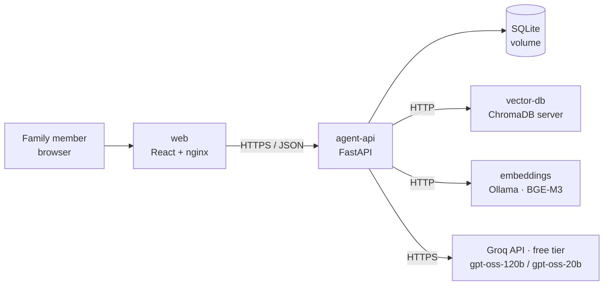
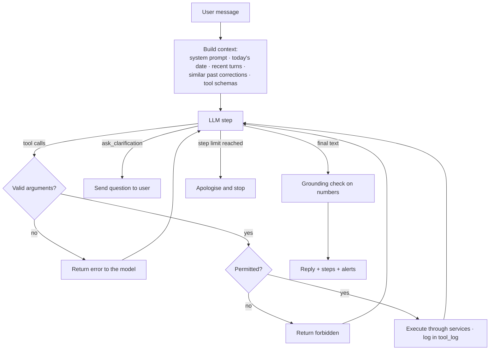

# Family Budget Agent — Architecture Specification

**Project:** Family Budget Agent (Graduation Project 2)
**Author:** Ayham Al-Salem · **Supervisors:** Dr. Nasreen Suleiman, Eng. Zainab Baghdadi
**Version:** 1.3 · 4 November 2026 · **Branch:** `gp2-agent` · Changes since 1.0 are listed in §14.

This document turns the methodology of *Report Part 1* (Chapter 4) into a specification that the code is written from. It records every architectural decision taken after Seminar 1. When the code and this document disagree, fix one of them; do not leave them out of sync.

---

## 0. Decisions

| # | Decision |
|---|---|
| D1 | Build on the Graduation Project 1 (GP1) repository. GP1 is moved unchanged into `baseline/` and stays runnable: it is the baseline for RQ2. |
| D2 | The fixed pipeline is replaced by a ReAct tool-calling agent. **`openai/gpt-oss-120b`** through the Groq API is the main model; **`openai/gpt-oss-20b`**, from the same family, is compared in the same agent. No fine-tuning. *Why not Llama, as planned in Report Part 1:* Groq withdrew Llama 3.3 70B and Llama 3.1 8B from its free and developer tiers on 16 August 2026 (enterprise only); the project's key gets 404 for both. Groq names the two gpt-oss models as their replacements. |
| D14 | The project runs on **Groq's free tier** only (no payment possible). Every design and evaluation choice must fit its per-model limits (§9.5). |
| D3 | Every number is computed by SQL inside a tool. The LLM never produces a number that a tool did not return. |
| D4 | Four services under Docker Compose: `web` (React), `agent-api` (FastAPI), `vector-db` (ChromaDB), `embeddings` (Ollama + BGE-M3). |
| D5 | Family accounts: one family, several members. Two roles: **manager** and **member**. Members join with an invite code created by a manager. |
| D6 | Visibility: a manager sees and manages everything. A member sees and edits only their own expenses, and sees family-level totals, budgets and goals (not other members' expenses). |
| D7 | Permissions are enforced inside the service layer. The family and the member are injected by the server from the login token; the LLM can never choose them. |
| D8 | The agent is also a household financial assistant: budget and trend alerts, savings goals, and advice built only from the family's own numbers. No investment or loan advice. |
| D9 | Advice has no separate tool: the agent calls the data tools first and advises from their results. The unsourced percentages in GP1's prompt are removed. |
| D10 | Currencies: old Syrian pound, new Syrian pound and US dollar. Old ↔ new is fixed (two zeros removed: 1 new = 100 old). The USD rate is set by the family manager, not fetched from the internet. |
| D11 | Scope is frozen by the priorities in §11. A lower priority never starts before the higher one works. If time runs short, cut from the bottom. |
| D12 | The baseline is frozen: its bugs are **not** fixed, because they are part of what RQ2 measures. Its only changes are environment overrides (§3.1): two for paths, and, from step 8, one for the model name, because GP1 hard-codes the Llama ID that Groq no longer serves. It keeps the existing root `venv/`; GP2 uses its own `backend/.venv`. |
| D13 | Git history is not rewritten (the large `venv` files from the first commit stay), so that `gp1-final` and the repository link already given to the university remain valid. |

---

## 1. System overview



| Service | Contents | Port (dev) | Persistent volume |
|---|---|---|---|
| `web` | React SPA built with Vite, served by nginx; Arabic, right-to-left | 8080 | — |
| `agent-api` | FastAPI: auth, REST API, agent loop, tools, services, SQLite access, Groq client | 8000 | `sqlite_data` |
| `vector-db` | ChromaDB in server mode; collections `expenses` and `corrections` | 8001 (internal) | `chroma_data` |
| `embeddings` | Ollama serving `bge-m3` (1024-dimensional vectors) | 11434 (internal) | `ollama_models` |

Only `web` and `agent-api` are exposed to the host. Secrets (`GROQ_API_KEY`, `JWT_SECRET`) come from `.env`, never from the UI and never from the repository.

**During development** the services run without Docker: `uvicorn` for the API, `chroma run` for ChromaDB (from `backend/.venv`), `ollama serve`, and `npm run dev` for React. Ollama is warmed up at API start-up with one embedding request, because the first request after a cold start takes about 30 seconds. Until React exists, the agent is tested through a small CLI (`python -m app.cli`) and FastAPI's built-in Swagger page (`/docs`). GP1's Streamlit app remains available inside `baseline/` for demonstrating the old system.

---

## 2. Repository layout

```
smart-family-budget/
├── baseline/                  # GP1, moved unchanged (git mv). Run from inside this folder with ..\venv
│   ├── app.py  config.py  src/  evaluation/  tests/  requirements.txt  README.md
│   └── data/                  # budget.db and chroma_db/, moved by hand (untracked, in .gitignore)
├── venv/                      # GP1's Python environment, untracked, used only by baseline/
├── backend/
│   ├── app/
│   │   ├── main.py            # FastAPI app and routers
│   │   ├── settings.py        # configuration from environment variables
│   │   ├── cli.py             # terminal chat for development
│   │   ├── api/               # routers: auth, chat, expenses, summary, budgets, goals, family, actions, health
│   │   ├── auth/              # password hashing, JWT, current-member dependency
│   │   ├── db/                # models, session, seed, the 12 categories (from GP1 config.py)
│   │   ├── services/          # all SQL logic + permission checks (used by tools AND by the API)
│   │   │   ├── periods.py  expenses.py  reports.py  budgets.py  goals.py  insights.py  currency.py  members.py
│   │   ├── rag/               # embeddings client (Ollama), vector store (Chroma HttpClient)
│   │   ├── llm/               # Groq client: tool calling, retries, logging, model registry
│   │   ├── agent/             # loop, context, memory, prompts, clarification, corrections, grounding
│   │   └── tools/             # tool schemas (JSON) + thin wrappers around services
│   ├── tests/                 # pytest: services, tools, permissions, agent loop with a mocked LLM
│   ├── data/                  # fba.db (untracked)
│   ├── .venv/                 # GP2's Python environment (untracked)
│   ├── .env                   # GROQ_API_KEY, JWT_SECRET (untracked, never printed or committed)
│   ├── requirements.txt       # exact versions (==)
│   └── Dockerfile
├── web/                       # React + Vite + TypeScript, Tailwind (RTL), Recharts
├── eval/                      # evaluation DB generator, experiment runners, metrics, scorers
├── data/eval/                 # evaluation datasets (JSONL) + annotation guidelines
├── docs/                      # this file; GP1 report PDF moved here
├── gp2_docs/                  # kept where it is (already shared with the supervisors)
├── pytest.ini                 # testpaths = backend/tests (never collect baseline/tests)
├── docker-compose.yml
├── .env.example
└── README.md                  # GP2 README; GP1's README moves to baseline/
```

**pytest must never collect `baseline/tests`:** those files are manual scripts. `test_parser.py` calls Groq, and `test_embedding.py` overwrites IDs 1–5 in GP1's real ChromaDB.

**Why `services/` sits between tools and the database:** the agent's tools and the React API need exactly the same queries and the same permission rules. Writing them once in `services/` means a permission bug cannot exist in one path and not the other.

---

## 3. What happens to the GP1 code

### 3.1 Reuse map

| GP1 file | What we take | Where it goes |
|---|---|---|
| `config.py` | The 12 categories with `budget_percent` and `keywords`; Groq, Ollama and Chroma settings | `backend/app/db/categories.py`, `backend/app/settings.py` |
| `src/database/models.py` | `Family`, `Category`, `Expense`, `Budget` | `backend/app/db/models.py`, extended (§4) |
| `src/database/crud.py` | add / update / delete expense, totals, totals by category, recent expenses | `backend/app/services/expenses.py`, `reports.py`: any date range, member filter, permissions |
| `src/database/seed.py` | Category seeding, sample family | `backend/app/db/seed.py`, with members and demo history |
| `src/rag/embedding.py` | Ollama `/api/embed` call, Chroma upsert and query | `backend/app/rag/`: `HttpClient`, family filter, second collection |
| `src/rag/retriever.py` | `get_alerts` (80% / 100% rule) | `backend/app/services/insights.py` |
| `src/analysis/spending.py` | `get_monthly_report` (used by GP1's sidebar); `get_comparison` (never called in GP1, current vs previous month only) | `services/reports.py` → `/summary` and `compare_months` (any two months) |
| `src/llm/parser.py` | `_call_llm` retry logic, `_parse_json` | `backend/app/llm/client.py`, rewritten for tool calling |
| `src/llm/prompts.py` | Category list, Syrian-dialect number and date hints ("تلاف", "نص مليون", "مبارح") | `backend/app/agent/prompts.py` |
| `src/chat/engine.py` | — (this is the fixed pipeline) | Stays only in `baseline/` |
| `evaluation/` | 180 test sentences, scripts, charts, results | Stays in `baseline/evaluation/` |

**The only change allowed inside `baseline/`** is two environment overrides in `config.py`, each with a comment:
- `BASELINE_DB_PATH` → `DB_PATH` (and therefore `DATABASE_URL`).
- `BASELINE_CHROMA_DIR` → `CHROMA_PERSIST_DIR`.

Without them set, GP1 behaves exactly as before. The RQ2 experiment sets both, so that GP1 reads the evaluation database **and** an evaluation ChromaDB. Otherwise GP1's query context would include its own unrelated stored expenses (§9.2).

**Third override, added in step 8:** `BASELINE_LLM_MODEL`. GP1 hard-codes `llama-3.3-70b-versatile` in `src/llm/parser.py` and `src/chat/engine.py`, and Groq no longer serves it (D2). In RQ2, GP1 therefore runs with the agent's main model, so that both systems use the same model and only the architecture differs. Without the variable, GP1 keeps its original ID. GP1's thesis results (Llama 3.3 70B) stay as the historical record; the RQ2 numbers come from the new run.

**Risk to check in step 8:** gpt-oss models spend part of `max_tokens` on reasoning. GP1's parser allows only `max_tokens=200`, so outputs could be cut before the JSON ends. A pilot run on 20 of GP1's sentences decides. If truncation appears, the override may also need GP1's reasoning effort, set to the same value as the agent's; that change would be documented here before the run.

**Running the baseline:** from inside `baseline/` with the root environment, e.g. `cd baseline` then `..\venv\Scripts\python -m streamlit run app.py`. Running from the repository root fails on `from config import …`. `venv/` is not moved, because it contains absolute paths.

**Official GP1 results:** the evaluation run of **14 May 2026** (`eval_results_20260514_165928`) is the one reported in the GP1 thesis (62 of 160 expense sentences failed; 94 correct, 4 wrong category). The later run of 15 May 2026 (77 failures, 9 of them questions) was never committed; it is committed into `baseline/evaluation/results/` as an additional run and is not cited.

### 3.2 Problems found in the GP1 code and how they are fixed

| # | Problem in GP1 | Fix in GP2 |
|---|---|---|
| P1 | One JSON object per message, one `add_expense` call | Agent loop with several tool calls per message |
| P2 | Every question answered from the same current-month summary; the LLM picks the numbers | Question-specific SQL tools for any period (D3) |
| P3 | No conversation history; a reply to "كم المبلغ؟" is processed on its own | `messages` table; recent turns sent with every request |
| P4 | Unclear category silently falls back to "متفرقات". Worse: an empty category from the model becomes "أكل وشرب" (`"" in cat` is always true), and `null` raises `TypeError` | `ask_clarification` tool; category validated against the enum, never fuzzy-matched |
| P5 | `update_expense` / `delete_expense` defined but never called, and without any ownership check | `edit_expense` / `delete_expense` tools with confirmation and permission checks |
| P6 | `budgets` table defined but never used; limits always `income × budget_percent` | Budgets table used; `set_budget` tool; percentage only as default |
| P7 | No currency on expenses | `currency`, `amount_base`, `rate_to_base` on every expense |
| P8 | Chroma search not filtered by family | Every vector query filtered by `family_id` (and `member_id` for members) |
| P9 | Retries only in the parser; answers to questions, advice and chat called the API without retries, at temperature 0.7 | One LLM client with retries for every call; temperature 0 for tool decisions |
| P10 | In the 14 May run (the one in the thesis), 81 of 180 sentences failed with technical errors, including all 10 questions. Most were API timeouts or rate limits, some were unreadable model output (JSON). Questions were only checked for type, never for answer correctness | Failed requests counted; numerical questions scored against reference answers (§9). The final report says "technical errors (API or unreadable output)" |
| P11 | Dates: only "today" and "yesterday" | Period resolver (§7.4) |
| P12 | Advice prompt contains percentages without a source | Removed; advice uses only the family's numbers (D9) |
| P13 | `family_id = 1` fixed; API key typed in the UI; engine rebuilt on every Streamlit rerun | Accounts and JWT (§5); key only in `.env`; one long-lived client |
| P14 | 17 `__pycache__` files committed; empty `src/llm/utils.py`; empty `{src…` folders left by a failed `mkdir` | Removed |

**Further problems found in the code review of 4 November** (handled in GP2; left as they are in the baseline, D12):

| # | Problem in GP1 | Handling in GP2 |
|---|---|---|
| A1 | On a 429 in the last attempt, `_call_llm` returns `None`; `_parse_json(None)` then raises `AttributeError` outside any `try` | The client raises a typed error after the last attempt; the loop turns it into a counted failure |
| A2 | HTTP 5xx is not retried | 5xx and timeouts are retried with backoff |
| A3 | Ollama timeout 30 s, while a cold first embedding takes about 30.4 s: the embedding is silently skipped and ChromaDB no longer matches SQL | Timeout 120 s, warm-up at start-up, `expenses.embedded_at`, and re-indexing of rows where it is empty |
| A4 | Ollama availability checked once at start-up; if Ollama starts later it is never used | Checked per call and in `/health` |
| A5 | ChromaDB uses the default L2 distance; `family_id` stored as text in metadata | Collections created with cosine distance; metadata stored with real types |
| A6 | `tests/` are manual scripts with no `assert`; pytest would collect them, calling Groq and writing into ChromaDB | Real pytest tests in `backend/tests`; `pytest.ini` restricts collection |
| A7 | `datetime.utcnow` (deprecated); amounts stored as `Float`; unpinned requirements | Timezone-aware UTC timestamps; `Numeric(14, 2)`; exact versions |
| A8 | The UI pre-fills the API key field from the environment, so the key reaches the browser; no authentication | Key only on the server; accounts and JWT |
| A9 | Arabic text and emoji in `print` calls can raise `UnicodeEncodeError` on Windows when output is redirected | No `print` in services; the baseline is run with `PYTHONIOENCODING=utf-8` |

---

## 4. Data model (SQLite via SQLAlchemy 2.0)

All amounts are stored twice: as entered (`amount`, `currency`) and converted to the family's base currency (`amount_base`). Every total, budget and comparison uses `amount_base`, so mixed currencies add up correctly.

| Table | Columns | Notes |
|---|---|---|
| `families` | `id, name, monthly_income, base_currency, usd_rate, created_at` | `base_currency` ∈ {`SYP_NEW`, `SYP_OLD`, `USD`}, default `SYP_NEW`. `usd_rate` = units of new SYP per 1 USD, set by a manager. Income is stored in the base currency. |
| `members` | `id, family_id, name, username (unique), password_hash, role, is_active, created_at` | `role` ∈ {`manager`, `member`}. A family may have more than one manager. |
| `invites` | `id, family_id, code (unique), role, created_by, expires_at, used_by, used_at` | Random 8-character code, valid 7 days, single use. |
| `categories` | `id, name_ar, name_en, budget_percent, keywords, icon` | The same 12 categories as GP1, global to all families. |
| `expenses` | `id, family_id, member_id, category_id, amount, currency, amount_base, rate_to_base, description, source_text, expense_date, goal_id, created_by_agent, embedded_at, created_at, updated_at` | `source_text` = the original message. `goal_id` only for the "ادخار" category. `created_by_agent` marks rows recorded through chat. `embedded_at` is empty until the row is stored in ChromaDB (A3). |
| `budgets` | `id, family_id, category_id, monthly_limit, month, created_at` | `month` = `YYYY-MM`, or `NULL` for a recurring default. Limit in base currency. |
| `savings_goals` | `id, family_id, name, target_amount, deadline, status, created_by, created_at` | `status` ∈ {`active`, `done`, `cancelled`}. Progress = sum of linked "ادخار" expenses. |
| `messages` | `id, family_id, member_id, role, content, tool_summary, created_at` | `role` ∈ {`user`, `assistant`}. `tool_summary` = short list of the tool calls of that turn, e.g. `add_expense → #45`. |
| `pending_actions` | `id, family_id, member_id, message_id, tool_name, arguments, status, created_at, expires_at` | Edits and deletions waiting for confirmation (§6.5). |
| `corrections` | `id, family_id, member_id, message, wrong_call, corrected_call, created_at` | Mirrored in the Chroma collection `corrections` (§6.7). |
| `tool_log` | `id, message_id, family_id, member_id, step, tool_name, arguments, result, status, latency_ms, model, created_at` | Every tool call. `status` ∈ {`ok`, `error`, `invalid_args`, `forbidden`, `confirmation_required`, `not_found`}. |
| `llm_calls` | `id, message_id, model, step, attempt, status, http_status, latency_ms, prompt_tokens, completion_tokens, error, created_at` | Every API attempt, so that failures are counted (Objective 7). |
| `events` *(Priority 4)* | `id, kind, name_ar, start_date, end_date` | Ramadan, Eid al-Fitr, Eid al-Adha, school start, winter. Hijri dates computed per year. |

**Effective budget** for category *c* in month *m*: the `budgets` row for (*c*, *m*); else the recurring row for *c* (`month IS NULL`); else `monthly_income × budget_percent / 100` (the GP1 rule).

**Currency conversion** to base: `SYP_OLD → SYP_NEW` divide by 100; `SYP_NEW → SYP_OLD` multiply by 100; `USD ↔ SYP_NEW` through `usd_rate`. The rate used is saved in `rate_to_base`, so later rate changes do not rewrite history.

**Types:** money columns are `Numeric(14, 2)`; timestamps are timezone-aware UTC; models use SQLAlchemy 2.0 typed mappings (`Mapped[...]`).

**ChromaDB collections** (`expenses`, `corrections`) are created with cosine distance (`{"hnsw:space": "cosine"}`). Metadata keeps real types (`family_id` and `member_id` as integers). Every query passes a `where` filter on `family_id`, plus `member_id` for members.

The schema is created with `create_all` in a new database file (`backend/data/fba.db`); GP1's database is not migrated. Report Part 1 (Table 4.3) listed six tables; the extra tables here come from the decisions after Seminar 1 (D5, D8, D10) and from what the agent needs to work (`messages`, `pending_actions`, `llm_calls`). The final report will document the full schema.

---

## 5. Accounts and permissions

**Flows**
1. *Create family:* name, monthly income, base currency, and the first account. The creator becomes a manager.
2. *Invite:* a manager creates an invite code with a role. The new person registers with the code and joins that family.
3. *Login:* username and password (hashed with bcrypt). The API returns a JWT that holds only `member_id`. The family and role are loaded from the database on every request.

**Permission matrix** (enforced in `services/`, D7)

| Action | Manager | Member |
|---|---|---|
| Add an expense | ✅ | ✅ (recorded under their name) |
| See, edit, delete own expenses | ✅ | ✅ |
| See, edit, delete other members' expenses | ✅ | ❌ |
| Family totals, breakdown by category, budget status, goals | ✅ | ✅ |
| Breakdown or totals by member | ✅ | ❌ (only "me") |
| Search expenses by meaning | All family expenses | Own expenses only |
| Set income, budgets, USD rate | ✅ | ❌ |
| Create or cancel savings goals | ✅ | ❌ (can contribute and view) |
| Create invites, remove members, change roles | ✅ | ❌ |

A denied tool call returns `{"ok": false, "error": {"code": "forbidden"}}`. The agent then explains politely that only the family manager can see this, without asking for names. No prompt wording can bypass this, because the check is not in the prompt.

**Member filters:** for a member, any member filter other than themselves ("me", their own name, username or id) is refused with `forbidden` **before any lookup**, so a member cannot even learn whether a name exists in the family.

---

## 6. The agent

### 6.1 Request flow



### 6.2 Loop rules

- The loop is plain Python with direct function calling, without a heavy agent framework, so that every step can be traced and evaluated (Report Part 1, §4.3.1).
- At most **6 LLM steps** per message. Several tool calls returned in one step are executed in order.
- Tool decisions use **temperature 0** (where the model accepts it) and **`reasoning_effort=low`** (§6.3). `max_tokens` = 1024, which includes reasoning tokens.
- An invalid call (unknown tool, missing or wrong-typed argument) is not executed. The validation error goes back to the model as the tool result and counts as a step.
- **Rejected by the provider:** Groq checks tool calls against the schemas and rejects a broken one with HTTP 400 `tool_use_failed`. This is not a connection failure. The error goes back to the model in the same turn ("Your last tool call was rejected: … Fix the arguments or omit optional ones"), counts as a step, and is logged in `tool_log` as `invalid_args`. At most **2 corrections** per turn; after that the agent asks the user to rephrase (not "connection problem").
- `ask_clarification` ends the turn: its `question` is the reply.
- Each request carries a `ToolContext(family_id, member_id, role, today, model, message_id)`. Tools receive it from the server. It is never part of the tool schemas the LLM sees.

### 6.3 LLM client (`llm/client.py`)

- Groq OpenAI-compatible chat completions with the `tools` parameter (native function calling).
- Models in a registry: `main` = `openai/gpt-oss-120b`; `small` = `openai/gpt-oss-20b` (D2). Both answered a native tool call with valid JSON arguments in step 4b.
- `reasoning_effort` is a setting (`REASONING_EFFORT`, default `low`). In step 4b, `low` cut completion tokens by about 40 % on both models and the tool call stayed correct. That was one sentence only; step 5 confirms it on more examples before it is fixed for the evaluation.
- Every call records `usage` (prompt, completion and reasoning tokens) in `llm_calls`, because the token budget decides the size of the evaluation (§9.5).
- **Fallback mode:** if native tool calling proves unreliable for a model, the client switches to a JSON-in-text mode with the same schemas. The loop does not change.
- Timeout 30 s. Up to 3 retries with exponential backoff and jitter; on HTTP 429, wait for the `retry-after` header when present. Every attempt is written to `llm_calls`. A request that still fails returns a friendly message and is **counted as a failure** in evaluation. A client-side limiter keeps each model under its per-minute token limit, so that 429 errors are avoided rather than retried. It starts from `x-ratelimit-remaining-tokens` of the last response and Groq's continuous refill (limit ÷ 60 tokens a second), so a request waits only for the missing tokens; before any header it uses a rolling 60 s window. Its estimate is **calibrated per model**: a moving average (weight 0.3) of actual ÷ estimated tokens, plus a 10 % margin (the raw estimate overshot by about 1.7× in step 5a). A `retry-after` longer than 60 s is treated as the daily quota running out. Report Part 1 (§4.3) allowed a tier with higher limits during evaluation; that is not possible (D14), so the evaluation is planned within the free tier (§9.5).

### 6.4 System prompt (`agent/prompts.py`)

The prompt is in English, as short as possible (every call pays for it, §9.5), and contains, in this order:
1. Role: "ميزان", a household budget assistant that replies in the Syrian dialect.
2. Today's date, the family's base currency, and the 12 categories, **each listed once with 2–4 short keywords** from `db/categories.py` (e.g. فواتير: كهربا، ماي، نت، اشتراك). The tool schemas carry no category enum (§7.1).
3. Rules, from the step 5a measurement:
   - Only numbers and dates that appear in this turn's tool results; no own math, no invented percentages or years.
   - Currencies are named in Arabic to the user (ليرة قديمة, ليرة جديدة, دولار), never as codes such as `SYP_OLD`.
   - The category is inferred from the keywords; ask only if it is really unclear ("دفعت 50 لأبو أحمد"), or if the amount is missing.
   - A dollar amount goes to `add_expense` with `USD`; on `missing_fields: usd_rate`, tell the user the family manager must set the dollar rate first.
   - To edit or delete a described expense ("آخر مصروف"), find its id with `list_expenses` or `search_expenses` first; ask only if several match. Edits and deletions always need confirmation.
   - "وزعلي / حسب الفئات" → `get_breakdown`; "كم باقي من الميزانية" → `check_budget`.
   - "وين / على شو صرفت على X": X is a category → `list_expenses`; otherwise `search_expenses`. Search before asking.
   - `forbidden` → only the family manager can see this; never ask for names.
   - Outside household budgeting (requests to transfer or pay money, investment, loans): decline at once, without tools or questions.
4. Dialect hints carried over from GP1: "تلاف" = thousands, "ألفين" = 2000, "نص مليون" = 500000, "مبارح" = yesterday, "هالشهر" = this month.
5. Advice policy (D9): for "how can I save?" questions, call `check_budget` and `compare_months` first (`get_insights` and `check_savings_goal` join when Priority 2 exists), then advise only from those numbers.
6. Up to 3 retrieved past corrections, as examples (§6.7, Priority 3).
7. One fixed example of tool calls, written separately and never taken from the test set.

### 6.5 Confirmation of edits and deletions

1. The model calls `edit_expense` or `delete_expense` without `confirmation_id`.
2. The service checks ownership and creates a `pending_actions` row. It returns `confirmation_required` with a preview and the `confirmation_id`.
3. The assistant shows the preview and asks. In React, confirm and cancel buttons call `POST /actions/{id}/confirm` or `/cancel` directly.
4. In chat, a confirmation is accepted only in a **later user turn**: the model calls the tool again with `confirmation_id`. The server executes it only if the pending action was created in an earlier message, by the same member, and is less than 10 minutes old. The model therefore cannot confirm its own request within one turn.

### 6.6 Clarification

- **Structural (Priority 1):**
  - Missing required arguments, or `missing_fields` returned by a tool, lead the model to `ask_clarification`.
  - The user's answer is linked to the request through the recent turns in memory.
- **Sampling agreement (Priority 2, from Report Part 1):**
  - On the first step, the model is sampled *n* times at temperature 0.7, plus once greedily at 0.
  - The signature of an action = tool name + normalised decisive arguments (amount, category, currency, date, expense_id).
  - Agreement = share of samples whose signature equals the greedy one. Below a threshold τ (initially 0.6, tuned on a development set), the agent asks.
  - *n* = 3 and *n* = 5 are compared on accuracy and on the number of API calls.
- **Requests no tool can serve** (e.g. transferring money) are declined with an explanation. This covers the fourth unclear type of *Learning to Ask*.

### 6.7 Correction memory (Priority 3, RQ3)

- **When a correction is recorded:** an expense with `created_by_agent = true` is changed by an edit, through chat or through the UI.
- **What is stored:** the original message, the original call, and the corrected call, in `corrections`.
- **How it is retrieved:**
  - The message is embedded with BGE-M3 and stored in the Chroma collection `corrections`, with `family_id` in its metadata.
  - For each new message, the top *k* = 3 corrections of the same family are retrieved by cosine similarity, keeping only those under a cosine-distance threshold tuned on a development set.
  - They are added to the prompt as examples.
- The memory can be switched off (`CORRECTIONS_ENABLED=false`), for the controlled RQ3 experiment.

### 6.8 Conversation memory

The last 10 user/assistant messages of the same member from the last 24 hours, each with its `tool_summary`. References such as "امسحه" or a bare "3000" after a question can then be resolved.

### 6.9 Grounding check

After the final reply, numbers in the text are extracted and checked against that turn's tool results. Unmatched numbers are logged as `ungrounded` in `tool_log`. At run time this is only logged; in evaluation it becomes the **grounding rate** metric (§9).

**Normalisation and tolerances** (from the step 5a false alarms):
- Arabic-Indic digits, "," / "٬" and spaces between groups of three digits are normalised ("١٥ ٠٠٠" = 15000). "ألف / آلاف / تلاف / k" multiply by 1,000 and "مليون" by 1,000,000 ("15 ألف", "26k").
- List numbering at the start of a line ("1." "2)") is ignored.
- A number is compared with the precision it is shown with, so a rounded value is accepted ("183 ألف" for 182,500; "65%" for 65.4). Signs are compared away, because the reply states the direction in words.
- A percentage must match a percentage in the results, or the ratio of two numbers of the same result object, within ±0.1 (or the shown precision).
- A year (2000–2100) is accepted only if a date in the results has it, so a wrong year is still caught.

---

## 7. Tools

Every tool returns JSON: `{"ok": true, "data": …}` or `{"ok": false, "error": {"code": …, "message": …}}`.

### 7.1 Priority 1 — core (11 tools)

| Tool | Arguments (required **bold**) | Returns | Permission |
|---|---|---|---|
| `add_expense` | **amount** (number > 0), **category** (one of the 12; checked on the server), currency (enum, default family base), date (YYYY-MM-DD, default today), description, goal_name | id, stored values, `amount_base`, budget alerts | all |
| `edit_expense` | **expense_id**, **changes** {amount, category, currency, date, description}, confirmation_id | preview + `confirmation_required`, or the updated row | own / manager |
| `delete_expense` | **expense_id**, confirmation_id | preview + `confirmation_required`, or done | own / manager |
| `list_expenses` | period, category, member, limit (default 10) | rows with ids, newest first | members: own only |
| `get_total` | **period**, category, member | total in base currency, count | member filter: manager or "me" |
| `get_breakdown` | **period**, by ∈ {category, member} | rows with totals and shares | `by=member`: manager |
| `compare_months` | **month_a**, **month_b** (YYYY-MM), category | both totals, difference, change % | all (family level) |
| `search_expenses` | **query**, period, limit (default 5) | matching expenses by meaning | members: own only |
| `check_budget` | category (all if omitted), period (a month: `this_month`, `last_month` or `YYYY-MM`; default `this_month`) | spent, limit, remaining, % used, status | all |
| `set_budget` | **category**, **amount**, month (omit = recurring), currency | the stored limit | manager |
| `ask_clarification` | **question**, **missing_fields** (free text, e.g. amount, category, expense) | ends the turn | all |

`list_expenses` is not in Report Part 1, Table 4.2. It is added because edits and deletions need a way to find the expense being referred to ("امسح آخر مصروف").

**Loose schemas, strict validation.** Groq rejects a call that breaks the schema before the server sees it (HTTP 400 `tool_use_failed`, §6.2), so the schemas sent to the model are loose: categories have **no enum** (the 12 names are listed once in the system prompt, §6.4), **no argument allows `null`**, every optional argument says "omit if unknown", and `ask_clarification.missing_fields` is free text. Strictness stays in the server's argument models (pydantic): only the 12 category names are accepted, and any error goes back to the model as `invalid_args`.

### 7.2 Priority 2 — financial assistant (basic)

| Tool | Arguments | Returns | Permission |
|---|---|---|---|
| `set_savings_goal` | **name**, **target_amount**, **deadline**, currency | the goal | manager |
| `check_savings_goal` | name (all active if omitted) | saved, remaining, months left, required per month, on track | all |
| `get_insights` | month (default current) | budget alerts (≥ 80 %, ≥ 100 %) and trend alerts | all |

**Trend alert:** month-to-date spending in a category exceeds the average of the same day-span in the previous 3 months by at least `TREND_THRESHOLD` (default 30 %). It needs at least 2 months of history.

### 7.3 Priority 3 and 4

| Priority | Tool | Purpose |
|---|---|---|
| 3 | `convert_currency` (**amount**, **from**, **to**) | Conversion with the family's rates |
| 4 | `forecast_month` (category) | Moving average of the last 3 months (Report Part 1, Table 4.2) |
| 4 | `detect_anomalies` (period) | Unusual expenses by z-score within each category |
| 4 | `upcoming_events` (months_ahead = 1) | Coming events, with spending in the same period last year when history exists |

### 7.4 Periods

`period` is either a keyword or an explicit range. Keywords: `today`, `yesterday`, `this_week`, `last_week`, `this_month`, `last_month`, `last_3_months`, `this_year`, `custom`. With `custom`, `start_date` and `end_date` are required. Dates are resolved on the server from `ToolContext.today`, which can be fixed through `AGENT_TODAY` for reproducible evaluation. The first day of the week is a setting (`WEEK_START`).

---

## 8. REST API (FastAPI)

| Method and path | Purpose | Role |
|---|---|---|
| `POST /auth/register-family` | Create family + first manager → token | public |
| `POST /auth/join` | Register with an invite code → token | public |
| `POST /auth/login` · `GET /me` | Login; current member, family and role | public · any |
| `POST /chat` | `{message}` → `{reply, steps[], pending_action?, alerts[]}` | any |
| `GET /messages` | Recent conversation | any (own) |
| `GET /expenses` · `PATCH /expenses/{id}` · `DELETE /expenses/{id}` | Table view and direct edits (same services and permissions) | any (scoped) |
| `POST /actions/{id}/confirm` · `/cancel` | Confirm or cancel a pending edit or deletion | owner of the action |
| `GET /summary?month=` | Dashboard: income, total, remaining, categories with limits, alerts, goals | any |
| `GET /budgets` · `PUT /budgets` | Read or set limits | any · manager |
| `GET /goals` · `POST /goals` | Savings goals | any · manager |
| `GET /members` · `POST /invites` · `DELETE /members/{id}` · `PUT /members/{id}/role` | Family management | manager |
| `PUT /family` | Income, base currency, USD rate | manager |
| `GET /health` | Status of the database, Chroma, Ollama and the Groq key | public |

`steps[]` lists each tool call of the turn (tool, arguments, status, latency). The React agent-steps panel shows it.

---

## 9. Evaluation design

### 9.1 Datasets (`data/eval/`, JSONL, one item per line)

| File | Fields | Target size (Report Part 1, Table 4.4) |
|---|---|---|
| `expenses.jsonl` | id, text, expected {amount, currency, category, date}, source, second_check | 300–400, incl. GP1's 160 |
| `tool_cases.jsonl` | id, turns[], expected_calls[{tool, args}], expected_behavior ∈ {execute, ask, decline}, unclear_type | 150–200, about 50 unclear |
| `numeric_questions.jsonl` | id, question, reference (computed by the generator) | ≥ 100 |
| `correction_sequences.jsonl` | id, steps[{message, expected_call, correction?}] | sequences of up to 50 corrections |
| `scenario_month.jsonl` | a month of realistic turns run by the student | replaces the family user study |

- `source` ∈ {`written`, `generated_reviewed`}. Variations suggested by an LLM are allowed only after review by the student (Report Part 1, §4.4). Report Part 1 also says the test set is written by people only: results on `generated_reviewed` items are therefore reported separately, and the final report describes the split.
- Test items are fixed before any experiment and checked for overlap with the prompt examples.
- About 20–30 % of the labels are checked by a second annotator (`second_check`).

### 9.2 Evaluation database (`eval/generate_eval_db.py`)

- Fixed random seed. One synthetic family (two members) with 12 months of history, relative to the run date.
- The same records are written to:
  - a database with the GP2 schema, and the GP2 evaluation collections in ChromaDB;
  - a database with the GP1 schema at `BASELINE_DB_PATH`, and a separate GP1 ChromaDB at `BASELINE_CHROMA_DIR`, filled with GP1's own embedding text and metadata format.
- **Dates:** GP1 always uses the real `date.today()`. The database is therefore generated on the day of the experiment, the experiment runs on that same day, and `AGENT_TODAY` is set to that date. Both systems then see the same "current month".
- Reference answers are computed directly from the generated records with independent code (pandas), not through the tools. Otherwise the tools would be tested against themselves.

### 9.3 Metrics

| Metric | Definition |
|---|---|
| Tool selection accuracy | Expected tools called, in the expected order |
| Argument accuracy | Exact match per argument (amount, category, currency, date, expense_id), as ArgEM in AISA-ArabicFC |
| Task success | All expected calls correct and the final database state correct |
| Clarification accuracy | Asked when it should, did not ask when it should not (precision / recall) |
| Numeric answer accuracy | The reference number appears in the reply, after normalisation; same scorer for GP1 and the agent |
| Grounding rate | Share of numbers in replies (answers and advice) that appear in tool results |
| API failure rate | Requests that still failed after retries; **counted as wrong** |
| Latency, LLM calls per message | From `llm_calls` and `tool_log` |

### 9.4 Experiments

| Question | Setup |
|---|---|
| **RQ2** | `numeric_questions` on GP1 (`baseline/`, its own fixed summary) vs the agent; both with `gpt-oss-120b`, on the same evaluation database |
| **RQ1** | `expenses`, `tool_cases` and `numeric_questions` with the agent on `gpt-oss-120b` vs `gpt-oss-20b`; same prompts, tools and reasoning effort. The question is unchanged from Report Part 1: whether a smaller model of the same family approaches the larger one inside the same agent |
| **RQ3** | `correction_sequences` with `CORRECTIONS_ENABLED` off vs on; same order; error rate over the sequence |
| Clarification | Structural only vs structural + sampling (*n* = 3, *n* = 5) |

Every run writes `results/<run_id>/` with its configuration, model, git commit, per-item outputs and the summary. Requests are spaced to respect rate limits.

**Running GP1 in RQ2:** the runner calls GP1 from inside `baseline/` with the root `venv`, `PYTHONIOENCODING=utf-8`, and the `BASELINE_*` variables set (paths and model). Ollama is warmed up first. Each item is wrapped in `try/except`, so a GP1 crash (e.g. A1) is recorded as a failure, as in GP1's own evaluation.

### 9.5 Working within Groq's free tier (D14)

**Limits per model** (each model has its own quota):
- **Seen in the response headers in step 4b:** 1,000 requests a day, and 8,000 tokens a minute.
- **Reported in Groq's published free-plan table:** 30 requests a minute, and 200,000 tokens a day. To be confirmed from the headers in step 5.

**What follows:** with about 200,000 tokens a day, the binding limit is **tokens per day**. For example, at 2,500 tokens per agent call that is about 80 calls a day per model, and at 1,250 tokens about 160. So:

1. **Lean calls:** a short system prompt, short tool descriptions, and `reasoning_effort=low`. **Target: ≤ 1,500 tokens per call on average.** Step 5 measures the real figure on a fixed set of 20 messages.
2. **Quota for final runs:** development uses a mocked LLM in tests and `gpt-oss-20b` for manual trials. `gpt-oss-120b` is kept for the final runs, as far as possible.
3. **Resumable runs:** every item's result is saved as soon as it is computed. A run that reaches the daily limit stops cleanly and continues the next day from the next item. Long runs go overnight.
4. **Single-step extraction:** `expenses.jsonl` is scored on the first tool call only, without generating the reply text.
5. **Sampling clarification:** *n* = 3 on a subset (all unclear cases plus the same number of clear ones). *n* = 5 only if the budget allows.
6. **Sizes from the budget:** after step 5, the calls each experiment needs are counted, and the final dataset sizes are fixed within the days available (Report Part 1 already calls the sizes targets to be confirmed with the supervisors). Runs start as soon as each dataset file is frozen, not at the end.
7. **Fallback for the small model:** if the laptop has at least 16 GB of RAM, `gpt-oss-20b` can also run locally through Ollama, without a quota. It would be used only if the cloud quota runs out, and the report would state it.

---

## 10. Web interface (React)

- **Stack:** React + Vite + TypeScript, Tailwind CSS with `dir="rtl"`, Recharts. Library versions are pinned at setup.
- **Pages:**
  - Login / create family / join with code.
  - **Chat** with confirm and cancel buttons and a collapsible **agent steps** panel.
  - **Dashboard:** income, spent, remaining, category bars against limits, alerts, goals.
  - **Expenses** table with filters, edit and delete.
  - **Budgets** (manager).
  - **Goals.**
  - **Family:** members, invites, roles, income, USD rate.
- **Visibility:** the UI hides what a role cannot do, but the server is the authority (§5).

---

## 11. Build order

| Step (Seminar 1 pipeline) | Dates | Work | Done when |
|---|---|---|---|
| 3 · Architecture | 2–3 Nov | This document | Approved |
| 4a · Repository restructure | 4–5 Nov | Pull `origin/main`; branch `gp2-agent`; remove tracked `__pycache__`, empty `utils.py` and `{src…` folders; `git mv` GP1 into `baseline/` (PDF report → `docs/`); move `data/` by hand; commit the 15 May run; add the two `BASELINE_*` overrides; `.gitignore` and `pytest.ini`; commit this document; push the branch | Baseline still reads its family (income 500,000) and its 5 ChromaDB entries from `baseline/data/`; branch on GitHub |
| 4b · Backend foundation | 5–8 Nov | `backend/.venv` with pinned requirements; skeleton, settings, `.env`; models and seed; services for expenses and reports with pytest on a temporary database; ChromaDB server with cosine collections; Ollama warm-up; Groq tool-calling smoke test with both models | `pytest` green; ChromaDB and Ollama reachable; both model IDs answer a tool call |
| 5a · LLM client, tools and ReAct loop | 5–12 Nov | Groq client with limiter and usage logging; the 11 core tools with schemas; the loop with grounding check; system prompt; CLI; tests with a mocked LLM; token measurement on 20 fixed messages | Multi-step example from Report Part 1 §4.3.1 works through the CLI; average tokens per call measured |
| 5b · Accounts and chat API | 12–18 Nov | Registration, invites, login (JWT), roles; `/chat` and the other §8 endpoints; permission tests through the API | Two members of one family see what §5 allows, through the API |
| 6 · Clarification and memory | 15–22 Nov | Structural clarification, `messages` memory, confirmations | "دفعت 50 لأبو أحمد" → question → answer linked; edit and delete need confirmation |
| 7 · Evaluation dataset | from 3 Nov, in parallel | Guidelines (3–5 Nov); 20–30 sentences a day; generator and numeric questions by 25 Nov; tool cases by 1 Dec; second-annotator sample by 3 Dec | Files frozen |
| 8 · Experiments RQ2, RQ1 + financial basic | 23 Nov – 6 Dec | Eval runners; RQ2; RQ1; sampling clarification; savings goals; `get_insights` | Result tables for RQ2 and RQ1 |
| 9 · RQ3, currency, React | 7–20 Dec | Correction memory and its experiment; currency; React app | RQ3 result; web app usable end to end |
| Priority 4 (if time) | 21 Dec – 1 Jan | Events, forecast, anomalies; results chapter; Seminar 2 slides | Seminar 2 ready |
| 10 · Deployment and report | 6–15 Jan | Docker Compose (4 services), README, clean-up, final report | `docker compose up` runs everything; report submitted 16–19 Jan |

**Fixed dates:** Seminar 2, 2–5 January · reports, 16–19 January · code committee, 23–26 January · final defence, 13–16 February.

---

## 12. Out of scope

Fine-tuning · enterprise microservices (API gateway, message broker, one database per service) · Milvus · Tool RAG · Telegram bot and voice input · user study with 10–15 families · bank connections and receipt scanning · fetching exchange rates from the internet · investment or loan advice · e-mail or mobile push notifications.

---

## 13. To verify

| Item | Status (step 4b, 4 Nov) |
|---|---|
| Groq model ID for Llama 3.1 8B, and native tool calling with both models | **Llama is not available.** Groq's `/models` for this project lists neither `llama-3.3-70b-versatile` (a request returns 404 `model_not_found`) nor any Llama 3.1 8B. Chosen instead: `MODEL_MAIN` = `openai/gpt-oss-120b`, `MODEL_SMALL` = `openai/gpt-oss-20b`. With "دفعت 5000 بنزين" and one `add_expense` tool, both return a native tool call with valid JSON arguments `{amount: 5000, category: "بنزين ومواصلات"}`, at the default reasoning effort and at `reasoning_effort=low`. Default → low: 120b 91 → 57 completion tokens (51 → 17 reasoning), 0.58 → 0.44 s; 20b 95 → 54 (62 → 21), 0.40 → 0.28 s; prompt 208 tokens. Rate-limit headers: 1,000 requests (daily window) and 8,000 tokens per minute per model. **Resolved in v1.2:** D2, D12, D14, §3.1, §6.2, §6.3, §9.4 and §9.5 |
| Daily token limit per model (reported as 200,000) | **Not shown in the response headers** (step 5a, 4 Nov). They give only `x-ratelimit-limit-requests: 1000` (a daily window: `reset-requests` was 1h1m55s after 43 requests, i.e. 86.4 s per request) and `x-ratelimit-limit-tokens: 8000` (per minute). The 200,000-a-day figure stays unconfirmed, so runs must stop cleanly on a 429 with a long `retry-after` (§9.5 item 3). The step 5a measurement used about 81,000 tokens on `gpt-oss-20b` and 60,000 on `gpt-oss-120b`, with no 429; requests left: 957 and 964. The step 5a2 re-measurement used about 56,000 and 46,000 tokens, again with no 429; requests left afterwards: 967 and 974 (the daily window refills continuously) |
| Average tokens per agent call | **Measured in step 5a** on the 20 fixed messages with `reasoning_effort=low`: **1,732 tokens per call on `gpt-oss-20b` and 1,714 on `gpt-oss-120b`, above the 1,500 target.** The prompt is about 1,660 of it: tool schemas 1,038, system prompt about 475, chat template about 70. Completion about 60 (reasoning about 11). A message takes 1.9 calls on average, about 3,260 tokens (20b) and 3,160 (120b); two expenses plus a budget check take about 7,200. Default reasoning on 5 of the messages: completion ×2–2.5, the advice message 6,379 instead of 3,896 tokens. With 8,000 tokens a minute, one message takes about a minute. Groq checks tool arguments against the schema: a value outside an enum or a `null` returns HTTP 400 `tool_use_failed` and the turn fails (3 of 20 messages on 20b, 1 on 120b). **Re-measured after step 5a2** (4 Nov): fresh seed database, date 2026-11-04, `low`; messages 1–4 as setup, then the 9 that failed or were weak (5, 9, 12, 14–19; 17 as the member). Tool schemas 1,038 → **898** tokens, but the system prompt grew to about 625 (the 12 categories and the new rules), so the first call still has about **1,594** prompt tokens. Average per call **1,786 (20b) and 1,758 (120b): the 1,400 target is not met.** Per message 4,168 and 3,126 (20b needs 21 calls for the 9 messages, 120b 16). **No `tool_use_failed`** with either model; on 20b, `ask_clarification` with an empty `missing_fields` was refused by the server's validation 3 times and corrected in the same turn. Wait before a call: 8.3 s on average (max 17) on 20b and 5.7 s (max 11) on 120b, against 16 s (max 56) before calibration. Results on the 9 messages, 20b: 5 correct, 2 partial, 2 wrong (was 0, 2, 7); 120b: 5, 4, 0 (was 3, 2, 4). Left wrong or partial: 20b asks for an amount that is given (#5) or after an empty search (#12), and searches for "بابا" instead of being refused (#17); 120b searches "الدكتور" in this month only (#12), writes the year 2024 for 2026 again (#14), and calls one fuel expense "several" (#15); both invent a savings target in the advice (#18) and skip `compare_months`. Grounding check: 4 numbers flagged on the new replies, all real errors (2024; "50 %", "10 %" and "10,000" in the advice). On the step 5a replies, false alarms fell from 24 to 3 (20b), 10 to 2 (120b) and 6 to 0 (default effort), and 2024 and "30–40 %" are still caught |
| Laptop RAM for running `gpt-oss-20b` locally | Open (fallback only, §9.5) |
| ChromaDB client and server versions | `chromadb` 1.5.7 in `backend/.venv` for client and server (`chroma run --path data\chroma --port 8001`). Heartbeat OK; `expenses` and `corrections` created with cosine distance (metadata and configuration). The server reports API version 1.0.0 |
| Ollama with `bge-m3` | Ollama 0.32.3, 1024-dimensional vectors. Warm-up with the model unloaded: 12.2 s; next request 0.5 s. `GET /health`: database, ChromaDB and Ollama `ok` |
| Node.js and npm | Not installed; needed before step 9 |
| Docker | Not installed; needed before step 10 |
| Ollama reachable from the `agent-api` container | Open (step 10) |
| *(Priority 4)* Hijri date library | Open |

---

## 14. Changes

### Version 1.3 (4 November 2026)

After the first token measurement (step 5a2):
- **§6.2:** a call that Groq rejects with HTTP 400 `tool_use_failed` goes back to the model as an error, at most 2 corrections a turn, then a clear request to rephrase; logged as `invalid_args`.
- **§7.1:** loose schemas and strict validation: no category enum, no `null`, "omit if unknown", free-text `missing_fields`; the server's pydantic models stay strict.
- **§6.4:** the 12 categories with keywords and the currency names are listed once in the system prompt, with rules for the failures measured in step 5a (category inference, dollars, edit and delete by description, search before asking, refusals, advice from tool numbers only).
- **§5:** a member asking about another member is refused before any member lookup, so no names leak.
- **§6.3:** the rate limiter is calibrated per model (moving average of actual ÷ estimated tokens, 10 % margin) and waits only for the missing tokens.
- **§6.9:** the grounding check normalises Arabic digits, digit groups, "ألف/k/مليون" and list numbering, accepts rounding to the shown precision and ±0.1 on percentages, and accepts a year only if a result date has it.
- **Seed:** expense descriptions are short Syrian phrases per category, so search by meaning has something to find.
- **§13:** results of the re-measurement.
- **Decisions taken in step 5a2 and accepted:** a `reasoning_tokens` column in `llm_calls`; enums kept only where the server must be exact (currency); a `not_available` error code; `check_budget` hides categories with no spending and no set budget; a `retry-after` longer than 60 s counts as the daily quota running out.

### Version 1.2 (4 November 2026)

After step 4b:
- **Models:** D2 now names `gpt-oss-120b` and `gpt-oss-20b`, with the reason (Groq withdrew Llama from the free and developer tiers on 16 August 2026). §1 diagram, §6.3 and §9.4 follow. RQ1 keeps its question with the new pair.
- **D14 and §9.5:** free tier only; a per-day token budget; lean calls; resumable runs; dataset sizes fixed from measured budgets.
- **D12 and §3.1:** a third baseline override for the model name (step 8), and the risk of reasoning tokens with GP1's `max_tokens=200`.
- **§6.2 and §6.3:** `reasoning_effort=low` as a setting; token usage stored per call; client-side rate limiting.
- **Decisions taken with the student in step 4b:**
  - `last_3_months` is the current month and the two before it.
  - Calendar periods cover the whole week, month or year.
  - `compare_months` orders the two months in time: the earlier one is the reference, and the change is null when its total is zero.
  - A USD expense without a family rate raises `MissingFieldsError(["usd_rate"])`; the demo family has no rate.
  - Seed passwords come from `SEED_MANAGER_PASSWORD` and `SEED_MEMBER_PASSWORD`, and the seed stops if they are missing.
- **Decisions taken in step 4b and accepted:**
  - Budget status: `ok` below 80 %, `warning` from 80 %, `over` from 100 %.
  - `pending_actions.status` ∈ {`pending`, `confirmed`, `cancelled`, `expired`}, and `tool_log` also allows `ungrounded`.
  - Rate columns are `Numeric(20, 10)`.
  - Editing only the amount keeps the stored rate; changing the currency uses the current rate.
  - `reindex_missing` stops at the first failure.

### Version 1.1 (4 November 2026)

From the code and environment review of GP1 before step 4:
- D12 and D13 added: frozen baseline with two environment overrides; separate Python environments; no rewriting of git history.
- §2: `baseline/data/`, `backend/.venv`, `backend/.env`, `pytest.ini`.
- §3.1: how the baseline runs; official GP1 results are the 14 May run; wording on `get_monthly_report` corrected.
- §3.2: P4, P10 and P14 made more precise; problems A1–A9 added.
- §4: `expenses.embedded_at`; `Numeric(14, 2)`; timezone-aware timestamps; ChromaDB with cosine distance and typed metadata.
- §6.7: cosine-distance threshold.
- §9.2 and §9.4: GP1 isolated with its own evaluation ChromaDB; same-day runs; how GP1 is run in RQ2.
- §11: step 4 split into 4a and 4b.
- §13: verification status.
